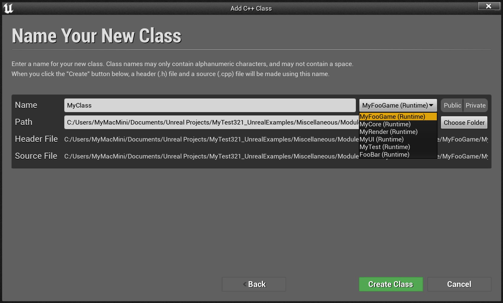
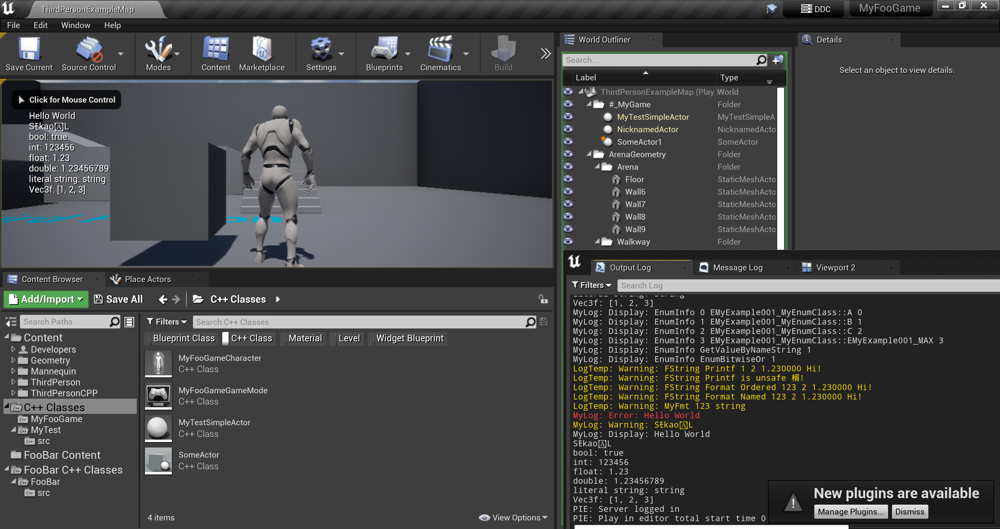

# Unreal Modules
- Modules in practice

## Requirements
- Unreal Editor 4.27.2
- Visual Studio 2022
- MSVC v143 - VS 2022 C++ x64/x86 build tools (v14.38-17.8) (Out of support)
- .NET Framework 4.8 SDK

### Maybe manually select MSVC version for UBT
***UBT may not happy when you have multi MSVC version in VS2022, cuz it default use higher version to compile.***

- Open **%APPDATA%/Unreal Engine/UnrealBuildTool/BuildConfiguration.xml** and modify kind of
```xml
<?xml version="1.0" encoding="utf-8"?>
<Configuration xmlns="https://www.unrealengine.com/BuildConfiguration">
    <WindowsPlatform>
        <!-- Please Replace Your MSVC version !! -->
        <!-- Check Your MSVC version: "C:\Program Files\Microsoft Visual Studio\2022\Community\VC\Tools\MSVC" !!-->
        <CompilerVersion>14.38.33130</CompilerVersion>
    </WindowsPlatform>
</Configuration>
```

## Building
- Run `gen_vs2022.bat`
- Open `MyFooGame.sln` and Compile/Run

## My Architecture
**A** -> **B** means **A** depends on **B**

At first i wanna use this folder sturcture, but failed.
```
Source
  ├─ external
  │  └─ fmt
  │     └─ fmt.Build.cs
  │
  ├─ MyLib
  │    ├─ MyCore -> fmt (All external lib)
  │    │  └─ MyCore.Build.cs
  │    ├─ MyRender -> MyCore
  │    │  └─ MyRender.Build.cs
  │    └─ MyUI -> MyRender
  │       └─ MyUI.Build.cs
  │
  └─ MyFooGame -> MyUI
     └─ MyFooGame.Build.cs
```

Finally, end up kind of this.
Cuz Unreal not suuprted deeply nested arrangement to discover a module,
which means Unreal Build Tool expects modules to be organized as modules under the project's **Source/Plugins** directory, with their ***.Build.cs** files in the module directory.
```
Plugins
  └─FooBar
    ├─ FooBar.uplugin
    └─ Source
	   └─ FooBar.Build.cs

MyFooGame.uproject
Source
  ├─ MyFooGame.Target.cs
  ├─ MyFooGameEditor.Target.cs
  │
  ├─ external
  │  └─ fmt
  │     └─ fmt.Build.cs
  │
  ├─ MyCore -> fmt (All external lib)
  │  └─ MyCore.Build.cs
  ├─ MyRender -> MyCore
  │  └─ MyRender.Build.cs
  ├─ MyUI -> MyCore, MyRender
  │  └─ MyUI.Build.cs
  ├─ MyTest -> MyCore, MyRender, MyUI
  │  └─ MyTest.Build.cs
  │
  └─ MyFooGame -> FooBar, MyCore, MyRender, MyUI, MyTest
     └─ MyFooGame.Build.cs
```

## Screenshots





## References
- https://flassari.notion.site/Modules-024fcf3439c34c7085faada2ebf52b14
- https://www.youtube.com/watch?v=2xzK0YXtl-I